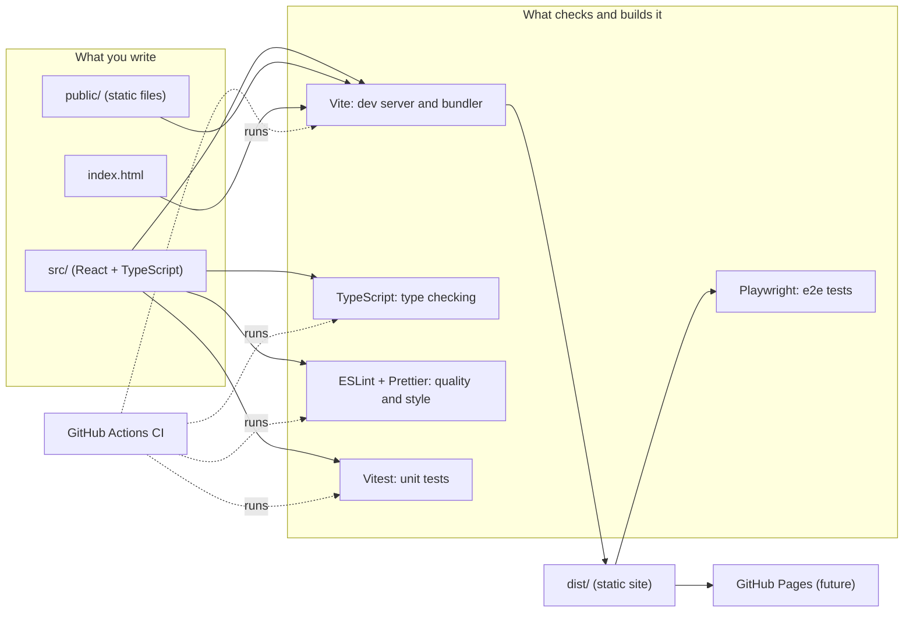
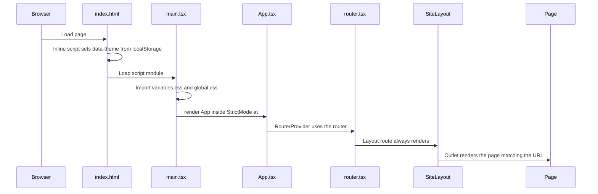
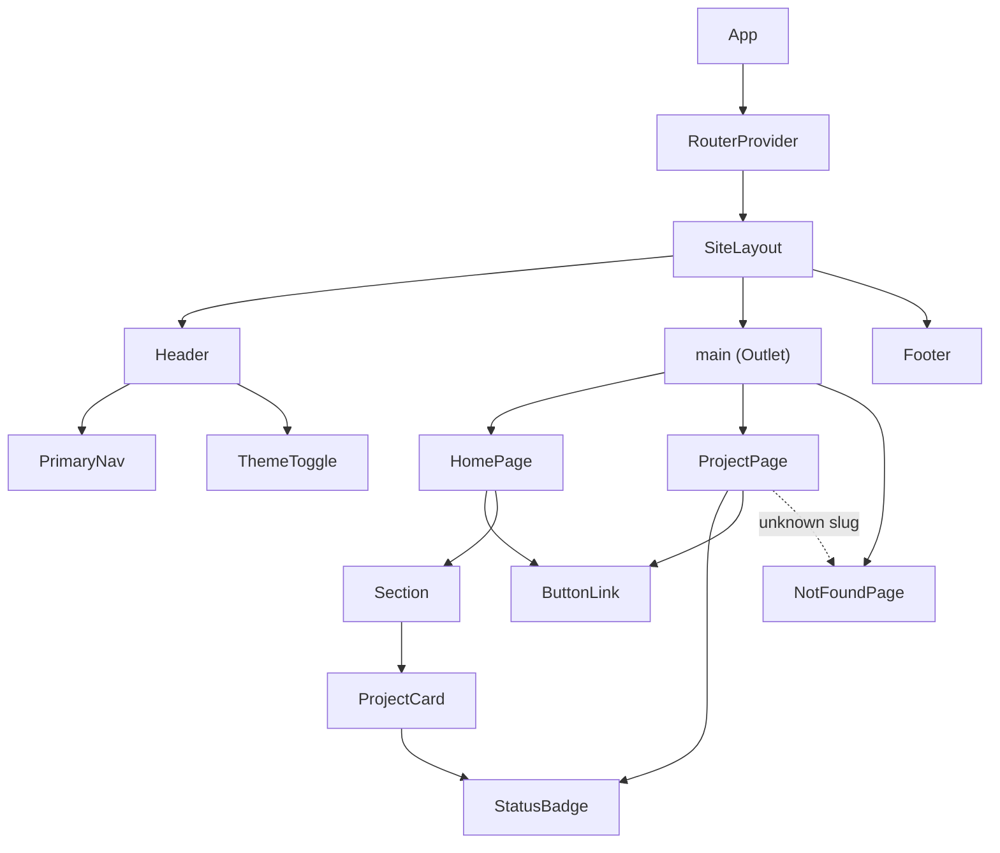
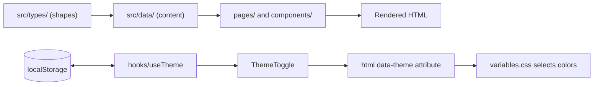
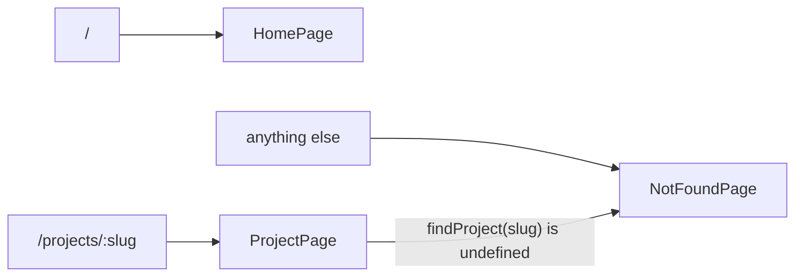
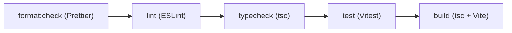

# Repository guide

A file-by-file map of the repo: what each part does, why it exists, and how the parts connect. Read it alongside [architecture.md](architecture.md) (the decisions) and [development.md](development.md) (the workflow).

## 1. Big picture

There is no server. The browser downloads `dist/`, and React runs entirely in the browser.

## 2. Runtime flow: what happens when the page loads

The inline script in `index.html` runs before React so the saved theme applies before first paint (no flash).

## 3. Component tree

## 4. Data flow

- Types define what a project, experience entry or skill category looks like.
- Data files hold the actual content, checked against those types by the compiler.
- Components render the data and contain no hard-coded content.
- The theme is changed by one attribute on `<html>`; CSS variables do the rest.

## 5. Routing

All routes sit under one layout route, so the header and footer never reload.

## 6. File-by-file reference

### Root configuration

| File                   | What it does                                              | Why it exists                                                                          |
| ---------------------- | --------------------------------------------------------- | -------------------------------------------------------------------------------------- |
| `package.json`         | Dependencies and npm scripts                              | Defines how to install, run, test and build.                                           |
| `package-lock.json`    | Exact dependency versions                                 | Makes installs reproducible (`npm ci`). Commit it.                                     |
| `index.html`           | The single HTML page; loads `src/main.tsx`                | Vite's entry point. Also holds the pre-paint theme script and metadata.                |
| `vite.config.ts`       | Vite and Vitest settings, base path                       | One config for dev, build and tests. `VITE_BASE_PATH` supports GitHub Pages sub-paths. |
| `tsconfig.json`        | Points to the two configs below                           | TypeScript "project references" keep browser and Node code separate.                   |
| `tsconfig.app.json`    | Strict compiler rules for `src/` and `tests/`             | Catches bugs at compile time. Stricter than the Vite default.                          |
| `tsconfig.node.json`   | Compiler rules for config files and `e2e/`                | These run in Node, not the browser.                                                    |
| `eslint.config.js`     | Lint rules: strict TypeScript, React Hooks, accessibility | Finds bugs and a11y problems that the compiler cannot.                                 |
| `.prettierrc.json`     | Formatting style                                          | Removes style arguments; formatting is automatic.                                      |
| `.prettierignore`      | Files Prettier skips                                      | Avoids formatting build output and the lockfile.                                       |
| `.gitignore`           | Files Git skips (`node_modules`, `dist`, reports)         | Keeps generated files out of history.                                                  |
| `.gitattributes`       | Forces LF line endings                                    | Prevents Windows/Linux line-ending noise and Prettier conflicts.                       |
| `playwright.config.ts` | Playwright settings; builds and previews the site         | Prepares end-to-end testing against the production build.                              |

### `public/` (copied to the output unchanged)

| File          | Purpose                                                                                     |
| ------------- | ------------------------------------------------------------------------------------------- |
| `favicon.svg` | Browser tab icon.                                                                           |
| `resume/`     | Optional location for a public-safe resume PDF; no resume is currently published or linked. |

### `src/app/`

| File              | Purpose                                                                                                             |
| ----------------- | ------------------------------------------------------------------------------------------------------------------- |
| `router.tsx`      | Route table (`routes`) and the browser router. Routes are exported separately so tests can use an in-memory router. |
| `App.tsx`         | Root component; hands the router to React Router. A natural place for future global providers.                      |
| `router.test.tsx` | Tests routing, the not-found page and the theme toggle through the real route table.                                |

### `src/main.tsx`

The program entry point. It imports global CSS, finds `#root` and renders `<App />`.

### `src/components/`

| File                                    | Purpose                                                                                        |
| --------------------------------------- | ---------------------------------------------------------------------------------------------- |
| `layout/SiteLayout.tsx`                 | Page shell: skip link, header, `<main>`, footer. Also scrolls to `#hash` targets.              |
| `layout/Header.tsx`                     | Site name link, primary nav and theme toggle.                                                  |
| `layout/Footer.tsx`                     | Copyright and GitHub/LinkedIn links.                                                           |
| `navigation/PrimaryNav.tsx`             | In-page section links inside a labelled `<nav>`.                                               |
| `projects/ProjectCard.tsx`              | One project summary card: name, status, tagline, technologies. Whole card is clickable.        |
| `ui/Section.tsx`                        | A titled `<section>` wired to its heading for accessibility. Used five times on the home page. |
| `ui/ButtonLink.tsx`                     | Styled link; adds `rel`/`target` and a screen-reader hint for external URLs.                   |
| `ui/StatusBadge.tsx`                    | Maps a project status to its label ("In Development") and colour.                              |
| `ui/ThemeToggle.tsx`                    | Button that switches theme; uses `useTheme`.                                                   |
| `*.module.css` (next to each component) | CSS Modules: class names are scoped to that component, so styles cannot leak.                  |

### `src/pages/`

| File               | Purpose                                                                                     |
| ------------------ | ------------------------------------------------------------------------------------------- |
| `HomePage.tsx`     | Hero plus experience, projects, skills, education and contact sections, built from `data/`. |
| `ProjectPage.tsx`  | Detail page for one project, looked up by URL slug.                                         |
| `NotFoundPage.tsx` | 404 content; also reused by `ProjectPage` for unknown slugs.                                |

### `src/data/` and `src/types/`

| File                  | Purpose                                                                       |
| --------------------- | ----------------------------------------------------------------------------- |
| `types/project.ts`    | `Project`, `ProjectStatus` and `ProjectLink` shapes.                          |
| `types/experience.ts` | `ExperienceEntry` shape.                                                      |
| `types/skill.ts`      | `SkillCategory` shape.                                                        |
| `data/projects.ts`    | Four projects, their current statuses and `findProject(slug)`.                |
| `data/experience.ts`  | Verified UPS roles, accomplishments, responsibilities and technologies.       |
| `data/skills.ts`      | Resume-based skills grouped by category.                                      |
| `data/site.ts`        | Name, title, summary, professional links, education and optional resume path. |

### `src/hooks/` and `src/styles/`

| File                     | Purpose                                                                                 |
| ------------------------ | --------------------------------------------------------------------------------------- |
| `hooks/useTheme.ts`      | Holds the theme, writes `data-theme` on `<html>`, persists to `localStorage`.           |
| `hooks/useTheme.test.ts` | Tests default, toggle, persistence and restore.                                         |
| `styles/variables.css`   | Design tokens (colours, spacing, type scale) for dark and light themes.                 |
| `styles/global.css`      | Reset, element defaults, focus ring, reduced-motion handling and the `.sr-only` helper. |

### Testing, CI and docs

| File                       | Purpose                                                                          |
| -------------------------- | -------------------------------------------------------------------------------- |
| `tests/setup.ts`           | Shared Vitest setup: jest-dom matchers, cleanup, `scrollTo` stub, storage reset. |
| `e2e/home.spec.ts`         | One Playwright smoke test; more come later.                                      |
| `.github/workflows/ci.yml` | On push and pull request: format check, lint, typecheck, test, build.            |
| `README.md`                | Entry point: purpose, setup, scripts.                                            |
| `docs/architecture.md`     | Design decisions and alternatives.                                               |
| `docs/development.md`      | Day-to-day workflow and how to add content.                                      |
| `docs/repository-guide.md` | This file.                                                                       |

## 7. Quality pipeline

Each step catches a different kind of problem: style, suspicious or inaccessible code, type errors, behaviour regressions, and build failures. CI runs the same sequence on every push and pull request.

## 8. Suggested way to learn this codebase

Follow a request from top to bottom rather than reading files alphabetically.

1. `index.html`, then `src/main.tsx`, `src/app/App.tsx`, `src/app/router.tsx`.
2. `SiteLayout.tsx`, then `Header.tsx` and `ThemeToggle.tsx`.
3. `useTheme.ts`, its test, `variables.css`, and how the `data-theme` attribute changes the colours (try it in the browser dev tools).
4. `types/project.ts`, `data/projects.ts`, `ProjectCard.tsx`, `HomePage.tsx`.
5. `ProjectPage.tsx` and routing tests.
6. The config files last, since they make more sense once you know what they serve.

Hands-on exercises, in order of difficulty:

- Change the summary in `site.ts` and watch the page update.
- Add a project entry using the steps in `development.md`.
- Break a type on purpose (for example, a wrong `status` value) and read the compiler error.
- Add a light-theme colour to `variables.css` and use it in one module.
- Write a test for `StatusBadge`.
- Consider extracting an `ExperienceItem` component if experience rendering grows more complex.
